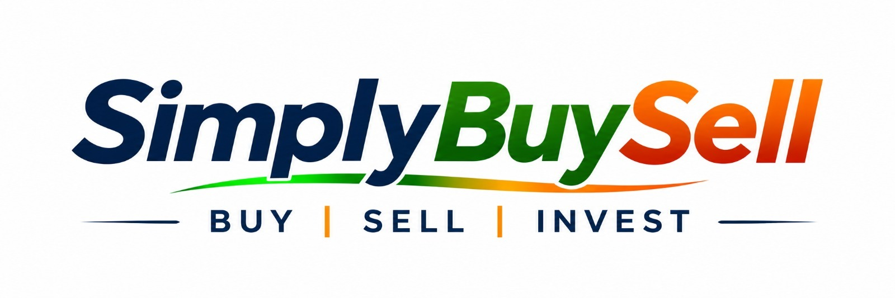

# SimplyBuySell — Amaravati Real Estate Marketplace

A complete, production-quality real estate platform dedicated to the Amaravati capital region and Andhra Pradesh. Built with modern React, Tailwind CSS, Lucide icons, and responsive design, inspired by the brand identity of **SimplyBuySell: BUY | SELL | INVEST**.



---

## 🌟 Key Features

### 1. Dynamic Hero Section & Slider
- **Dynamic 4-slide real-estate carousel** automatically changing every 6 seconds.
- Interactive controls: previous/next arrows, dot indicators, pause-on-hover/touch, and animated progress bar.
- Clean HTML/CSS text overlay keeping imagery pristine and accessible.
- Multi-action CTA buttons: **Explore Properties**, **Buy Property**, **Sell Property**, and **Know More**.

### 2. Comprehensive Navigation & Header
- **Top Information Bar**: Phone (`+91 98765 43210`), Email (`info@simplybuysell.com`), Location (`Andhra Pradesh, India`), Language Selector (`English`, `Telugu`), and Admin Quick Link.
- **Sticky Header**: Responsive desktop & mobile header with logo, navigation links, and prominent Buy / Sell interactive action pills.
- **Mobile Drawer**: Slide-in navigation drawer with touch-friendly links and direct WhatsApp/Phone actions.

### 3. Core Sections & Value Propositions
- **Welcome Section**: Mission statement for Amaravati region with verified highlight points.
- **Trust / Value Proposition**: 6 interactive cards with microinteractions:
  1. *Customer-Friendly & Flexible*
  2. *More Than Just a Transaction*
  3. *Trust, Clarity & Accurate Information*
  4. *Our Role in Your Journey*
  5. *Transparent & Responsible Platform*
  6. *Complete & Clear Details*
- **Trust Statement Banner**: *"Your Trust is Our Strength. Your Satisfaction is Our Goal."* with green & orange emphasis.
- **Animated Statistics Counter**: 4 counters (10K+ Properties Listed, 5K+ Happy Customers, 100% Trusted Platform, Andhra Pradesh Our Service Area) with viewport count-up animation, editable from CMS.
- **Services Section & Dedicated Pages**:
  - Residential Properties (`/services/residential`)
  - Commercial Properties (`/services/commercial`)
  - Open Plots (`/services/plots`)
  - Agricultural Lands (`/services/agricultural-land`)
  - Investment Opportunities (`/services/investment`)
  *Each with dedicated hero, overview, benefits, hotspots, available property cards, and FAQs.*
- **Open Properties CTA**: High-converting banner leading to ready-to-transact properties.
- **Customer Reviews**: Testimonials showcase with star ratings and a customer review submission modal with an admin approval workflow.
- **Contact CTA Banner**: Direct phone, email, and scheduled site-visit booking.
- **Dark Navy Footer**: Full link directory, social links, office address, and copyright.

### 4. Interactive Property Flows
- **Buy Property (`/buy`)**:
  - Search by title, location, type, or keyword.
  - Multi-criteria filters: Property Type (Flats, Apartments, Houses, Villas, Plots, Open Plots, Commercial, Agricultural Land), Location (Amaravati, Mangalagiri, Thullur, Vijayawada, Guntur, Tadikonda), Price Ranges (Under ₹25L, ₹25-50L, ₹50L-1Cr, ₹1Cr+), Bedrooms, Status, Furnishing.
  - Sorting: Newest, Price Low to High, Price High to Low, Most Popular.
  - Active filter pills, instant reset, and helpful empty state.
- **Property Detail Page (`/properties/:id`)**:
  - Multi-image gallery with clickable thumbnail selector.
  - Complete price breakdown, area, bedrooms, bathrooms, and status.
  - Comprehensive description, key highlights, amenities grid, and nearby landmark distances.
  - Verified partner card, Enquire Now modal, Schedule Site Visit modal, and dynamic WhatsApp button pre-filled with property title.
  - Mobile bottom sticky action bar (*Call | WhatsApp | Enquire*).
  - Similar properties recommendation.
- **Sell Property (`/sell`)**:
  - Professional seller submission form with contact details, property specifications, pricing, description, feature tags, and photo upload.
  - Confirmation modal upon submission.
- **Open Properties (`/open-properties`)**:
  - Dedicated page for available-now properties with quick filters and search.
- **Buyer's Choice (`/buyers-choice`)**:
  - Curated categories: *Best Flats, Best Villas, Best Plots, High-ROI Investments, Budget-Friendly, High-Growth Locations*.
- **Contact Page (`/contact`)**:
  - Direct helpline, office address, interactive Google Map, and validated contact form.

### 5. Admin Panel & CMS (`/admin`)
- **Dashboard Overview**: Metrics for Total Properties, Customer Enquiries, Seller Requests, and Reviews.
- **Property Management**: Add new properties, edit, delete, toggle Featured, and toggle Verified badge.
- **Enquiry System**: Update customer lead statuses (*New, Contacted, Follow-up, Site Visit Scheduled, Converted, Closed*).
- **Seller Submissions**: Review seller requests and update statuses (*Submitted, Under Review, Verified, Published, Rejected*).
- **Reviews Moderation**: Approve or reject user reviews before public publication.
- **Hero Slider CMS**: Toggle active slides and customize content.
- **Website Content & Stats CMS**: Update phone, email, office address, trust banner, and animated statistics in real time without code deployment.

### 6. WhatsApp & Communication Integrations
- Floating WhatsApp button with live pulse animation.
- Dynamic WhatsApp messages pre-filled with specific property titles.
- Schedule Site Visit booking with preferred date and time slots.

---

## 🛠 Tech Stack

- **Framework**: React 18 + Vite 6
- **Routing**: React Router DOM v6
- **Styling**: Tailwind CSS with custom branding colors (Deep Navy Blue, Royal Blue, Green, Orange, Light Gray)
- **Icons**: Lucide React
- **State & Persistence**: React Context API with persistent `localStorage` synchronization
- **SEO**: Semantic HTML, Open Graph tags, Twitter card tags, Schema.org `RealEstateAgent` JSON-LD, `sitemap.xml`, and `robots.txt`

---

## 🚀 Getting Started

### Prerequisites
- Node.js (v18 or higher)
- npm or pnpm

### Installation
```bash
# Clone the repository
git clone https://github.com/shaikmuzammil2911-ux/simply-buy-sell.git

# Navigate into the project directory
cd simply-buy-sell

# Install dependencies
npm install

# Start development server
npm run dev
```

### Production Build
```bash
npm run build
npm run preview
```

---

## 📄 License
© 2026 SimplyBuySell. All Rights Reserved.
